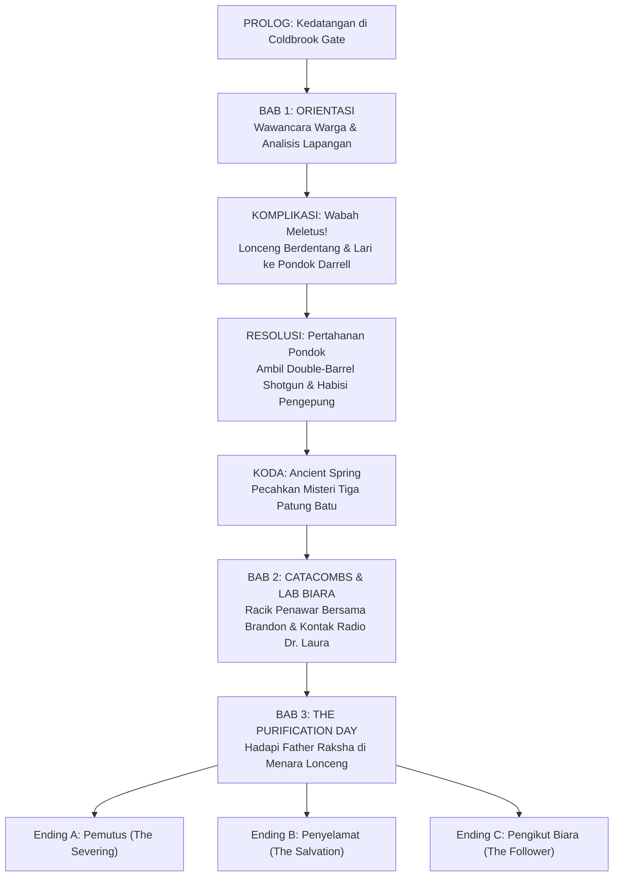

# 📜 COLD BLOOD ZOMBEY — ALUR CERITA & DOKUMEN NARATIF (STORY.MD)

> **Judul Game:** COLD BLOOD ZOMBEY  
> **Genre:** Retro PS1 Survival Horror & Narrative Mystery (1997 Aesthetic)  
> **Latar Tempat:** Coldbrook Village, Blackwood Moors, Yorkshire, Inggris (Abad ke-19 / Akhir 1990-an)  
> **Tokoh Utama:** **Rodrick** (Player / Mahasiswa Peneliti Antropologi & Lapangan)  
> **NPC Pemandu:** **Kristin** (Rekan Peneliti Kimia Air & Hidrologi Lingkungan)  
> **Antagonis Utama:** **Father Raksha** (Pemimpin Kultus Biara Coldbrook Abbey) & **Lady Mithrill / Matron Agnes**

---

## 🎭 KARAKTER UTAMA & TOKOH CERITA

| Nama Tokoh | Peran | Deskripsi Karakteristik |
| :--- | :--- | :--- |
| **Rodrick** | Protagonis (Player) | Mahasiswa peneliti yang merekam fenomena lapangan dengan alat perekam kaset analog dan jurnal catatan. Dingin, fokus, namun peka terhadap kejanggalan. |
| **Kristin** | Companion / Pemandu | Rekan riset Rodrick yang cerdas dan teliti. Membawa ransel uji sampel kimia air. Menjadi pemandu jalan *(Leader/Guide)* yang memberikan petunjuk arah dan analisis taktis. |
| **Old Thomas** | Warga Sepuh Gerbang | Pria tua bertopi pet wol tradisional (*flat cap*) dengan mantel *tweed*. Tersenyum ganjil tanpa henti sambil menawarkan cawan air suci sumur biara kepada siapapun yang tiba. |
| **Darrell the Huntsman** | Pemburu Paruh Baya | Pemburu yang tinggal di pondok timur berpagar tengkorak babi hutan. Menolak mentah-mentah ajaran biara, tidak tersenyum aneh, dan menyimpan senapan laras ganda (*double-barrel shotgun*). |
| **Mrs. Eleanor** | Tetua Jalur Barat | Nenek tetua Coldbrook yang tinggal di pondok dekat *Ancient Spring* (Mata Air Kuno). Mengetahui rahasia bait ritual pelarian kuno sebelum biara didirikan. |
| **Edward the Devout** | Warga Persimpangan | Warga desa yang pikiran dan ingatannya telah dicuci bersih oleh senyawa neurotoksin biara. |
| **Brandon (Relawan Riset)** | Asisten Lab Biara | Adik dari Dr. Laura yang sempat tersesat dan dijadikan subjek penjinakan emosi di ruang bawah tanah biara. |
| **Dr. Laura** | Kontak Radio Eksternal | Peneliti luar yang menghubungi Rodrick & Kristin melalui gelombang radio darurat untuk menghentikan penyebaran massal. |
| **Father Raksha** | Dalang Kultus Biara | Pendeta karismatik berpakaian jubah hitam-putih gothic yang meracuni sumur desa untuk menghapus memori, rasa bersalah, dan kehendak bebas manusia. |

---

## 🏛️ STRUKTUR NARATIF: 4 FASE UTAMA (ALUR GDD)

Cerita dirancang mengikuti struktur sastra klasik: **Orientasi ➔ Komplikasi ➔ Resolusi ➔ Koda**, dilanjutkan dengan Bab Eksplorasi Bawah Tanah dan Hari Penyucian.

---

## 📖 BAB 1: DESA SUNYI (THE SILENT PARISH)

### 1. Prolog: Kedatangan di Coldbrook Gate
* **Visual Sinematik**: Kamera retro PS1 menyorot kabut tebal menyelimuti dataran *Blackwood Moors*. Sebuah mobil *pick-up* bak terbuka kuno menurunkan Rodrick dan Kristin di depan gerbang batu *Coldbrook*. Rodrick mengaktifkan perekam pita kasetnya.
* **Dialog Prolog**:
  * **Rodrick (Kaset)**: *"Catatan lapangan hari pertama. Desa Coldbrook, lembah terpencil Blackwood Moors. Dua minggu riset komparasi ritual kuno dan kepercayaan lokal."*
  * **Kristin**: *"Dan dua minggu sampel hidrologi air moors. Jangan lupa bagian gue juga masuk ke bab laporan akhir, Rod."*
  * Seorang pria tua bertopi wol menyambut mereka dengan senyum yang tidak pernah pudar dari wajahnya (**Old Thomas**).
  * **Old Thomas**: *"Selamat datang di Coldbrook, anak-anak muda... Dinginnya moors menusuk tulang. Basuhlah tenggorokan kalian dengan air suci sumur biara Father Raksha..."*
  * **Kristin (Bisik)**: *"Ramah banget ya... Tapi senyum kakek ini aneh banget, Rod. Pupil matanya melebar dan tatapannya kosong."*

---

### 2. Fase Orientasi: Wawancara Warga (Eksplorasi Tangan Kosong)
* **Status Pemain**: Tangan Kosong (*Unarmed*). Kristin menjadi pemandu jalan yang memimpin Rodrick menjelajahi desa.
* **Objektif**: Wawancara 3 warga desa sebelum petang tiba.
  1. **Old Thomas (Gerbang Masuk)**:
     * Menyambut ramah namun terus mengulang kalimat: *"Pastor Raksha selalu membuka pintu bagi jiwa-jiwa yang haus keselamatan... kami semua diampuni."*
     * Analisis Kristin: Intonasi suara dan jeda kata terasa seperti rekaman mekanis.
  2. **Darrell the Huntsman (Pondok Timur - Pagar Tengkorak Babi Hutan)**:
     * Menolak tersenyum. Tatapannya tajam dan waspada.
     * Peringatan Darrell: *"Kalian berdua mahasiswa yang datang meneliti? Cepat kemasi barang kalian dan pergi sebelum malam tiba! Jangan pernah minum air sumur yang mereka bagi-bagikan! Jika terjadi sesuatu, aku menyimpan senapan laras ganda di atas mejaku!"*
     * Analisis Kristin: Darrell adalah satu-satunya warga yang menolak dogma biara.
  3. **Mrs. Eleanor (Gubuk Dekat Mata Air Kuno - Jalur Barat)**:
     * Bergumam di dekat aliran air: *"Tiga sujud, dua sembah, satu keheningan... begitulah nyanyian mereka..."*
     * Memberitahu bahwa jalan keluar gerbang utama telah dirantai oleh para pengikut setia (*the Devout*). Jalur rahasia terletak di balik gua *Ancient Spring*.
  4. **Edward the Devout (Persimpangan Desa)**:
     * Berlutut menatap botol air: *"Dinginnya malam tidak akan lagi menyakitkan jika menyerahkan beban pada biara..."*

---

### 3. Fase Komplikasi: Wabah Meletus & Lonceng Kematian
* **Pemicu**: Senja tiba. Dentang lonceng biara berbunyi liar sebanyak 7 kali di kejauhan.
* **Perubahan Suasana**:
  * Kabut putih berubah pekat bercampur semburat kemerahan.
  * Pupil mata para warga menghitam pekat, pembuluh darah di leher menonjol, dan mereka bermutasi menjadi mayat hidup (*The Devout Infected*).
  * Gerbang desa dikunci dengan rantai besi berat.
* **Tindakan**:
  * Kristin berteriak: *"Rod! Lonceng itu... mereka semua berubah! Darrell benar! Ayo lari ke pondok Darrell di timur dan ambil senapannya!"*
  * Player harus berlari menghindari sergapan warga yang bermutasi tanpa memiliki senjata api.

---

### 4. Fase Resolusi: Pertahanan di Pondok Darrell
* **Pengambilan Senjata**:
  * Rodrick dan Kristin menerobos masuk ke dalam pondok kayu Darrell.
  * Di atas meja kayu tua, Rodrick mengambil **Senapan Laras Ganda (Double-Barrel Shotgun M1887)** dan amunisi *Buckshot*.
* **Pertempuran Bertahan Hidup**:
  * Mayat hidup mengepung pintu dan jendela pondok.
  * Kristin beralih ke posisi tempur dan memberikan tembakan perlindungan.
  * Rodrick menembak jatuh gelombang pengepung pintu depan untuk mengamankan pondok.

---

### 5. Fase Koda: Misteri Mata Air Kuno (Ancient Spring Vault)
* **Objektif**: Menuju mata air kuno di bukit barat untuk membuka pintu batu pelarian.
* **Puzzle Tiga Patung Batu (Three Prostrations)**:
  * Di depan dinding batu terdapat 3 patung sujud kuno (*Kneeling Monks*).
  * Berdasarkan petunjuk nyanyian Mrs. Eleanor: *"Tiga sujud, dua sembah, satu keheningan"*.
  * **Solusi**: Tekan patung kiri 3 kali, patung tengah 2 kali, dan patung kanan 1 kali.
  * Pintu batu bergeser terbuka, menampakkan terowongan rahasia menuju katakombe bawah tanah di bawah katedral biara.

---

## 🕳️ BAB 2: DI BAWAH KATEDRAL BIARA (BENEATH THE ABBEY)

### 1. Eksplorasi Fasilitas Rahasia & Laboratorium
* Terowongan kuno berujung pada koridor batu bata gothic yang terhubung dengan laboratorium medis tersembunyi.
* Di sini terungkap bahwa "wabah kutukan" bukanlah mistis murni, melainkan **senyawa alkaloid neurotoksin** yang dicampurkan ke dalam air tanah biara untuk menundukkan kehendak manusia.

### 2. Pertemuan dengan Brandon & Kontak Radio Dr. Laura
* Di ruang generator, Rodrick dan Kristin menemukan **Brandon**, asisten lab yang hampir kehilangan ingatannya namun sempat menyembunyikan botol ampul dasar formula.
* Menghidupkan panel listrik 3 sekring kaca (Ruang Rawat, Dapur Air, Arsip).
* Radio pemancar menyala: **Dr. Laura** memberikan panduan untuk meracik penawar (*Antidote Compound*) sebelum ritual massal dilancarkan.

### 3. Pertarungan: Matron Agnes (Kepala Dapur Air Biara)
* Sosok perempuan berkerudung panjang yang tubuhnya bermutasi lentur menyerang dari kegelapan pipa air.
* **Mekanik Boss**: Player harus memutar 3 katup merah pipa air bertekanan tinggi untuk menghentikan aliran neurotoksin, melemahkan tubuh Matron Agnes, lalu menembak intinya.

### 4. Peracikan Senyawa Penawar (Antidote Synthesis)
* Di meja kimia laboratorium:
  * Urutan peracikan: **Ampul Dasar Brandon ➔ Cryo-Stabilizer Pendingin ➔ Sampel Air Murni Alami**.
  * Kristin menyimpan serum penawar ke dalam tabung penyuntik tekanan tinggi.

---

## ⛪ BAB 3: HARI PENYUCIAN (THE PURIFICATION DAY)

### 1. Puncak Menara Lonceng
* Rodrick dan Kristin naik ke alun-alun utama katedral biara. Ratusan warga yang terinfeksi berlutut seragam di bawah terpaan sinar bulan purnama.
* Di atas podium bertingkat berdiri **Father Raksha**.

### 2. Konfrontasi Ideologi
* **Father Raksha**: *"Dunia luar penuh dengan kebencian, dosa, dan rasa sakit. Air ini tidak membunuh mereka, Rodrick... air ini menyucikan pikiran mereka dari rasa bersalah. Mereka tenang dalam keheningan abadi."*
* **Rodrick**: *"Kamu tidak memberi mereka kedamaian. Kamu mencuri jiwa dan kemanusiaan mereka."*

### 3. Pertempuran Dua Fase: Father Raksha
* **Fase 1 (Wujud Manusia & Pengawal)**: Father Raksha memerintahkan gelombang pengikutnya mengepung sambil menembakkan proyektil darah okultis.
* **Fase 2 (Bentuk Mutasi Biara)**: Father Raksha menyuntikkan konsentrat mutasi ke jantungnya. Tubuhnya membesar dengan sayap bayangan gothic. Titik lemah berada pada rongga dada bercahaya (*Crimson Core*).

---

## 🎬 TIGA AKHIR CERITA (MULTIPLE ENDINGS)

| Ending | Nama Akhir | Syarat Pencapaian | Konklusi Cerita |
| :--- | :--- | :--- | :--- |
| **Ending A** | **Pemutus (The Severing)** | Menghancurkan tangki air biara dan membakar laboratorium tanpa menyebarkan penawar. | Wabah terhenti di Coldbrook, namun ingatan warga desa tidak pernah kembali. Rodrick dan Kristin menuruni bukit berkabut saat fajar menyingsing. Desa Coldbrook ditinggalkan sebagai desa mati. |
| **Ending B (Canon)** | **Penyelamat (The Salvation)** | Berhasil meracik penawar dan mengalirkannya ke seluruh sistem pipa saat menara lonceng diaktifkan. | Kabut merah memudar. Neurotoksin ternetralisir. Warga desa satu per satu tersadar dari pengaruh cuci otak. Tim penyelamat Dr. Laura tiba di perbatasan gerbang. Kehangatan kembali ke Blackwood Moors. |
| **Ending C (Secret)** | **Pengikut Biara (The Follower)** | Player memilih meminum cawan air suci yang ditawarkan saat konfrontasi dan menolak menyuntikkan penawar. | Rodrick berlutut di samping mayat Father Raksha. Matanya menghitam dan dingin merayap ke seluruh tubuhnya. Kristin menangis ketakutan saat Rodrick tersenyum kosong dan berbisik: *"Kami semua diampuni."* Rodrick menjadi pendeta baru Coldbrook. |

---

## 🛠️ CATATAN IMPLEMENTASI GAMEPLAY & SISTEM

1. **Mode Cerita (Story Mode)**:
   * Alur naratif berurutan dari prolog pick-up, investigasi desa tanpa senjata (*unarmed*), perbincangan interaktif dengan warga, komplikasi wabah, hingga baku tembak di pondok.
2. **Mode Bertahan (Endless Horde Mode)**:
   * Melewatkan dialog cerita; langsung dipersenjatai Shotgun M1887 Putar dan Golok Rimba untuk membasmi gelombang zombie tak terbatas bersama Kristin.
3. **Sistem Petunjuk Pemandu Kristin**:
   * **60 Detik**: Memberikan petunjuk arah mata angin umum.
   * **120 Detik**: Menyebutkan ciri-ciri fisik lokasi target (misal: tengkorak babi hutan).
   * **180 Detik / Tekan [H]**: Menuntun tepat ke titik target dan menggerakkan kompas live di HUD.

---
*Dokumen ini merupakan panduan resmi naratif dan alur skenario permainan **COLD BLOOD ZOMBEY**.*
